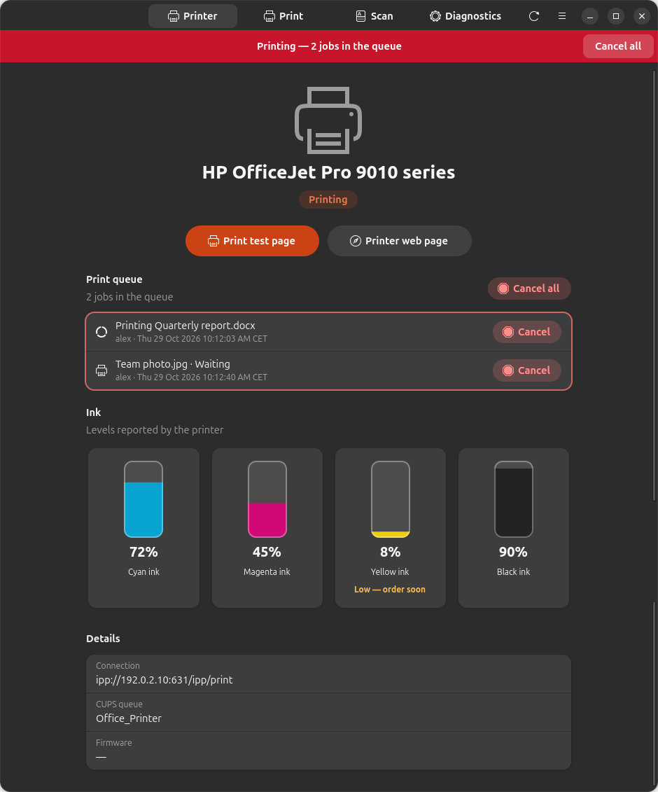
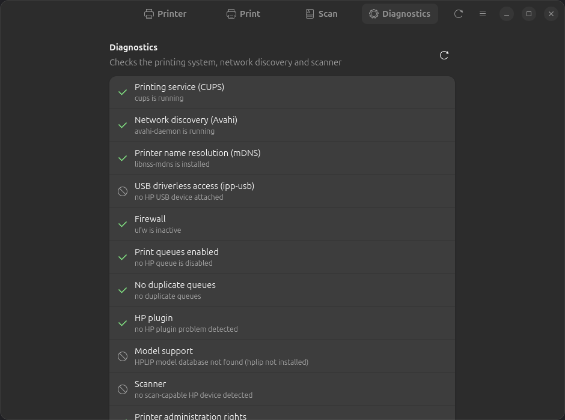

[English](README.md) · [Español](README.es.md) · **Deutsch** · [Français](README.fr.md) · [Nederlands](README.nl.md)

<div align="center">



# LibrePrint

**Jeden Drucker unter Linux nutzen — drucken, scannen und Tintenstände prüfen, ohne die App des Herstellers.**

[](https://github.com/juujbyg/libreprint/actions/workflows/ci.yml)
[](https://github.com/juujbyg/libreprint/releases/latest)
[](LICENSE)

</div>

Die Linux-Apps der Druckerhersteller sind unbequem, sofern es sie überhaupt gibt. LibrePrint findet
den Drucker (WLAN, Netzwerk oder USB), richtet ihn mit dem passenden Treiber ein und bietet eine
einfache App zum Drucken, Scannen, Überwachen der Tintenstände und Beheben von Problemen — unter
Ubuntu und Debian, mit einem einzigen Befehl.

Es funktioniert mit **jedem Drucker, der treiberloses Drucken (IPP Everywhere / AirPrint) unterstützt** —
fast jedes Modell der letzten zehn Jahre von HP, Canon, Epson, Brother, Samsung, Xerox, Lexmark,
Kyocera, Ricoh und anderen. **Ältere HP-Modelle**, die vor dem treiberlosen Drucken erschienen sind,
werden ebenfalls über HPLIP unterstützt.

> **LibrePrint steht in keiner Verbindung zu Druckerherstellern und wird weder von ihnen unterstützt
> noch gesponsert.** Markennamen sind Warenzeichen ihrer jeweiligen Inhaber und werden hier nur
> verwendet, um die Geräte zu beschreiben, mit denen das Werkzeug funktioniert.

## Funktionen

- **Einrichtung mit einem Befehl.** Erkennt Drucker beliebiger Hersteller im Netzwerk oder per USB
  und legt die Druckwarteschlange mit treiberlosem IPP Everywhere an; bei älteren HP-Modellen wird
  auf HPLIP zurückgegriffen.
- **Tintenstände auf einen Blick**, mit Warnung, wenn eine Patrone zur Neige geht.
- **Druckwarteschlange, die man sieht und steuern kann** — ein Banner auf jedem Bildschirm, solange
  etwas gedruckt wird, und ein Klick genügt, um einen Auftrag oder alle abzubrechen.
- **Jedes Dokument, auch mehrere gleichzeitig** — PDF, Bilder und Text werden direkt gedruckt. Word-,
  Excel-, PowerPoint-, OpenDocument- und ähnliche Dateien werden im Hintergrund mit LibreOffice
  umgewandelt; das Ergebnis lässt sich vorher ansehen, oder man klickt ohne Warten auf Drucken.
- **Druckoptionen** — Kopien, beidseitig, Farbe oder Graustufen, Qualität und Seitenbereiche. Die
  Seitenreihenfolge richtet sich nach dem Ausgabefach des Druckers, sodass der Stapel in
  Leserichtung herauskommt.
- **Mehrseitiges Scannen** in ein einzelnes PDF oder nach PNG/JPEG, mit Vorschau jeder Seite.
- **Diagnose**, die CUPS, Netzwerkerkennung, Firewall und Scanner prüft und für jedes Problem den
  Befehl nennt, der es behebt.
- **Automatikmodus** — einen USB-Drucker anschließen oder mit einem Netzwerk verbinden, und er wird
  automatisch eingerichtet.

## Screenshots

| Drucken | Scannen | Diagnose |
|:---:|:---:|:---:|
|  |  |  |

## Installation

**Option 1 — ein Befehl (empfohlen).** Fügt das LibrePrint-APT-Repository hinzu, installiert die App
und richtet den Drucker ein. Updates kommen zusammen mit dem Rest des Systems (`sudo apt upgrade`):

```sh
curl -fsSL https://juujbyg.github.io/libreprint/install.sh | sh
```

**Option 2 — das APT-Repository von Hand hinzufügen:**

```sh
curl -fsSL https://juujbyg.github.io/libreprint/libreprint.gpg \
  | sudo tee /usr/share/keyrings/libreprint.gpg >/dev/null
echo "deb [signed-by=/usr/share/keyrings/libreprint.gpg] https://juujbyg.github.io/libreprint stable main" \
  | sudo tee /etc/apt/sources.list.d/libreprint.list
sudo apt update && sudo apt install libreprint
sudo libreprint setup
```

**Option 3 — nur die `.deb`-Datei.** `libreprint_all.deb` vom
[neuesten Release](https://github.com/juujbyg/libreprint/releases/latest) herunterladen und
`sudo apt install ./libreprint_all.deb` ausführen (keine automatischen Updates).

Anschließend **LibrePrint** im Anwendungsmenü öffnen oder `libreprint gui` ausführen.

| | Befehlszeile | App |
|---|---|---|
| Ubuntu 26.04, 24.04 | ✅ | ✅ |
| Ubuntu 22.04 | ✅ | — (benötigt libadwaita 1.5) |
| Debian 13 | ✅ | ✅ |
| Debian 12 | ✅ | — (benötigt libadwaita 1.5) |

amd64 und arm64. Python 3.10 oder neuer, nur Standardbibliothek: Es wird nichts von PyPI installiert.

## Funktionsweise

LibrePrint ist **kein neuer Treiber**. Die Unterstützung für den Drucker ist im Linux-Drucksystem
höchstwahrscheinlich bereits vorhanden; LibrePrint ist der Kitt, der das passende Teil auswählt und
einbindet. Es baut auf Folgendem auf:

- [CUPS](https://openprinting.github.io/cups/) und IPP Everywhere (treiberloses Drucken),
- [ipp-usb](https://github.com/OpenPrinting/ipp-usb) (treiberloser Zugriff auf USB-Drucker),
- [HPLIP](https://developers.hp.com/hp-linux-imaging-and-printing) (Treiber für ältere HP-Modelle),
- [SANE](http://www.sane-project.org/) (`sane-airscan` für eSCL, `hpaio` für HPLIP-Scanner).

## Befehlszeile

```
libreprint gui
libreprint setup [--uri URI] [--yes] [--no-test-page] [--force]
libreprint list [--json]
libreprint doctor [--json] [--fix]
libreprint plugin [--yes]
```

| Befehl | Was er tut |
|---|---|
| `libreprint gui` | Öffnet die LibrePrint-App (auch im Anwendungsmenü). |
| `libreprint setup` | Erkennt Drucker und legt ihre Druckwarteschlangen an (sowie die Scannereinrichtung). `--yes` beantwortet alle Fragen automatisch. `--uri` konfiguriert eine bestimmte Geräte-URI, statt Geräte zu suchen. `--no-test-page` überspringt die Testseite. `--force` konfiguriert eine bereits vorhandene Warteschlange neu. |
| `libreprint list` | Zeigt erkannte Geräte als `MODELL  VERBINDUNG  METHODE  WARTESCHLANGE` an. `--json` liefert maschinenlesbare Ausgabe. |
| `libreprint doctor` | Führt die Diagnose aus und gibt für jede Prüfung `[ OK ]` / `[FAIL]` / `[WARN]` / `[SKIP]` samt vorgeschlagenem Befehl zur Behebung aus. `--fix` wendet die verfügbaren Korrekturen an. `--json` erzeugt Ausgabe zum Anhängen an Fehlerberichte. |
| `libreprint plugin` | Installiert das proprietäre HP-Plugin (siehe [Lizenzierung des HP-Plugins](#lizenzierung-des-hp-plugins)) und schließt anschließend jede Einrichtung ab, die darauf gewartet hat. |

`setup`, `plugin` und `doctor --fix` benötigen Root-Rechte. Als normaler Benutzer in einem Terminal
ausgeführt, startet sich LibrePrint selbst mit `sudo` neu; ohne Terminal endet es mit Code 3.

Exit-Codes: `0` in Ordnung, `1` Fehler, `2` falsche Verwendung, `3` benötigt Root, `4` kein Drucker
gefunden, `5` Benutzeraktion erforderlich (Plugin-Lizenz).

LibrePrint ändert oder löscht niemals eine Druckwarteschlange, die es nicht selbst angelegt hat, es
sei denn, `--force` wird angegeben. Zweimaliges Ausführen von `setup` ändert nichts.

## Wie der Treiber gewählt wird

Für jeden gefundenen Drucker wählt LibrePrint die erste zutreffende Methode:

1. **Treiberlos (IPP Everywhere).** Das Gerät bietet IPP Everywhere an (Rasterformate wie
   `image/pwg-raster` oder `image/urf`), über das Netzwerk oder über `ipp-usb`. Die Warteschlange
   wird mit `lpadmin -m everywhere` angelegt; `ipps://` wird `ipp://` vorgezogen.
2. **HPLIP** (nur HP). Das Modell ist in der installierten HPLIP-Datenbank
   (`/usr/share/hplip/data/models/models.dat`) als unterstützt aufgeführt und benötigt kein Plugin.
   Die Warteschlange verwendet die `hp:`-URI und den passenden `hpcups`-Treiber.
3. **HPLIP + Plugin.** Wie oben, aber die Datenbank kennzeichnet das Modell als abhängig vom
   HP-Plugin.
4. **Nicht unterstützt.** Ein Drucker eines anderen Herstellers ohne treiberlose Unterstützung (den
   Linux-Treiber des Herstellers installieren) oder ein HP-Modell, das dem installierten HPLIP
   unbekannt oder dort als nicht unterstützt aufgeführt ist; LibrePrint nennt den Grund, statt zu raten.

Das Scannen wird getrennt eingerichtet: Geräte beliebiger Hersteller, die eSCL anbieten
(`_uscan._tcp`, das „AirScan“-Protokoll), verwenden `sane-airscan`; andernfalls nutzen HP-Modelle mit
Scanfunktion `libsane-hpaio`.

Fehlende Pakete (zum Beispiel `sane-airscan`) werden mit `apt-get` installiert, außer
`install_packages = false` ist gesetzt. HPLIP gehört nicht zur Standardinstallation: `hplip` und
`printer-driver-hpcups` werden nur installiert, wenn ein HP-Modell sie benötigt.

## Seitenreihenfolge

Die App liest das Ausgabefach des Druckers über IPP aus. Landen die Seiten mit der bedruckten Seite
nach oben, druckt sie die letzte Seite zuerst, damit der Stapel in Leserichtung liegt. Landen sie
mit der bedruckten Seite nach unten, wird normal gedruckt, da dieser Stapel bereits stimmt. Drucker,
die ihr Fach nicht melden, erhalten die letzte Seite zuerst.

## Automatikmodus

Das Paket installiert eine udev-Regel und zwei systemd-Units:

- **USB:** Wird ein USB-Drucker angeschlossen, führt `libreprint-usb@.service` `libreprint auto --usb` aus.
- **Netzwerk:** `libreprint-netwatch.service` führt `libreprint watch` aus, das mDNS (Avahi) auf neue
  Drucker überwacht. Warteschlangen, die von CUPS-Servern anderer Rechner freigegeben werden, werden ignoriert.
- Direkt nach der Installation konfiguriert `libreprint auto --all` bereits angeschlossene Drucker.

Der Automatikmodus stellt nie Fragen, installiert das HP-Plugin nur nach ausdrücklicher Zustimmung
und löscht nie Warteschlangen (auch nicht, wenn ein Drucker abgesteckt wird).

Die Einstellungen stehen in `/etc/libreprint/libreprint.conf`:

```ini
[libreprint]
usb = true                       # USB-Drucker beim Anschließen konfigurieren
network = add                    # add | off: Warteschlangen für per mDNS gefundene Netzwerkdrucker
accept_hp_plugin_license = false # vor einer Änderung „Lizenzierung des HP-Plugins“ lesen
install_packages = true          # LibrePrint fehlende Pakete mit apt-get installieren lassen
```

Um den Automatikmodus zu deaktivieren, `usb = false` und `network = off` setzen oder
`sudo systemctl disable --now libreprint-netwatch.service` ausführen.

## Lizenzierung des HP-Plugins

Einige ältere Modelle benötigen das proprietäre HP-Plugin. LibrePrint verteilt es **nicht** weiter,
sondern ruft das eigene Werkzeug `hp-plugin` von HP auf, das das Plugin von HP herunterlädt und die
Lizenz von HP anzeigt.

- `sudo libreprint plugin` fordert zunächst dazu auf, die HP-Lizenz zu lesen und zu akzeptieren.
- Im Automatikmodus wird das Plugin nur installiert, wenn `accept_hp_plugin_license = true` gesetzt
  ist. Das Setzen bedeutet, die HP-Lizenz **im Namen aller Benutzer des Rechners** zu akzeptieren.
  Andernfalls merkt sich LibrePrint das Modell als ausstehend und weist darauf hin,
  `sudo libreprint plugin` auszuführen.

## Fehlerbehebung

`libreprint doctor` ausführen. Es prüft CUPS, Avahi und die mDNS-Namensauflösung, `ipp-usb`, eine
Firewall, die mDNS (5353/udp) blockiert, deaktivierte oder doppelte Warteschlangen, ein fehlendes
oder nicht passendes HP-Plugin, in der HPLIP-Datenbank fehlende Modelle, die Sichtbarkeit des
Scanners und die Mitgliedschaft in der Gruppe `lpadmin`. Zu jeder fehlgeschlagenen Prüfung gibt es
einen Befehl zur Behebung; `sudo libreprint doctor --fix` wendet die Korrekturen an.

## Ein Problem melden

Ein Issue mit der Vorlage *Printer not working* eröffnen und die Ausgabe von
`libreprint doctor --json` und `libreprint list --json` anhängen. Sobald der Drucker funktioniert
(oder nicht), bitte eine Zeile in [docs/HARDWARE.md](docs/HARDWARE.md) ergänzen.

## Deinstallation

```sh
sudo apt remove libreprint
sudo rm -f /etc/apt/sources.list.d/libreprint.list /usr/share/keyrings/libreprint.gpg
```

Von LibrePrint angelegte Druckwarteschlangen bleiben **erhalten**, sodass das Drucken weiter
funktioniert. Mit `lpadmin -x <queue>` lassen sie sich entfernen. `sudo apt purge libreprint` löscht
zusätzlich `/var/lib/libreprint`.

## Entwicklung

Direkt aus einem Klon ausführen, ohne Installation:

```sh
git clone https://github.com/juujbyg/libreprint.git
cd libreprint
PYTHONPATH=src python3 -m libreprint gui     # oder: list, doctor, ...
```

Siehe [CONTRIBUTING.md](CONTRIBUTING.md) für Tests, Paketierung und die Grundregeln des Projekts
sowie [docs/RELEASING.md](docs/RELEASING.md) für die Veröffentlichung einer neuen Version.

## Lizenz

GPL-2.0-or-later; siehe [LICENSE](LICENSE).
