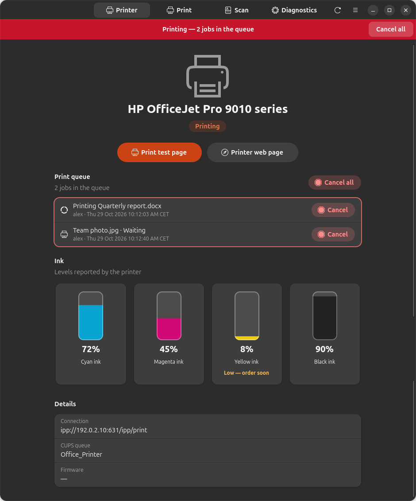
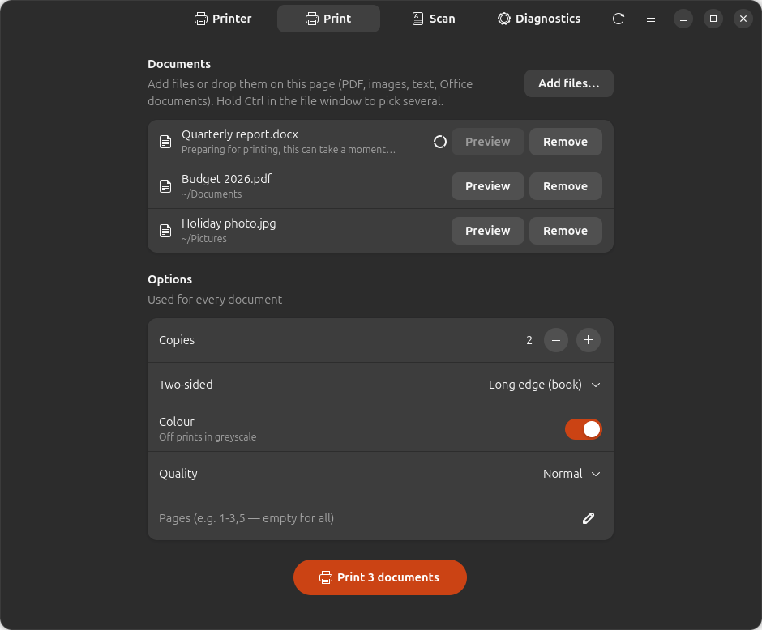
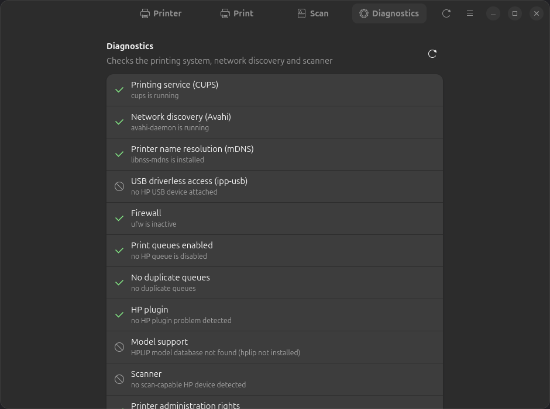

<p align="center"><a href="README.md">English</a> · Español · <a href="README.de.md">Deutsch</a> · <a href="README.fr.md">Français</a> · <a href="README.nl.md">Nederlands</a></p>

<div align="center">



# LibrePrint

**Usa cualquier impresora en Linux: imprime, escanea y revisa la tinta sin la app del fabricante.**

[](https://github.com/juujbyg/libreprint/actions/workflows/ci.yml)
[](https://github.com/juujbyg/libreprint/releases/latest)
[](LICENSE)

</div>

Las apps de los fabricantes de impresoras para Linux son incómodas, cuando existen. LibrePrint
encuentra tu impresora (Wi-Fi, red o USB), la configura con el controlador adecuado y te da una app
sencilla para imprimir, escanear, vigilar los niveles de tinta y resolver problemas, en Ubuntu y
Debian y con un solo comando.

Funciona con **cualquier impresora compatible con la impresión sin controlador (IPP Everywhere /
AirPrint)**, casi todos los modelos vendidos en los últimos diez años, de HP, Canon, Epson, Brother,
Samsung, Xerox, Lexmark, Kyocera, Ricoh y otras marcas. Los **modelos HP más antiguos**, anteriores
a la impresión sin controlador, también están cubiertos mediante HPLIP.

> **LibrePrint no está afiliado, respaldado ni patrocinado por ningún fabricante de impresoras.**
> Los nombres de marca son marcas registradas de sus propietarios y se usan aquí solo para describir
> los dispositivos con los que funciona la herramienta.

## Características

- **Configuración con un solo comando.** Detecta impresoras de cualquier marca en la red o por USB y
  crea la cola de impresión con IPP Everywhere sin controlador, recurriendo a HPLIP para los modelos
  HP antiguos.
- **Niveles de tinta de un vistazo**, con un aviso cuando un cartucho se está agotando.
- **Cola de impresión visible y controlable**: un banner en cada pantalla mientras se imprime y un
  clic para cancelar un trabajo o todos.
- **Cualquier documento, varios a la vez**: los PDF, las imágenes y el texto se imprimen
  directamente. Los archivos de Word, Excel, PowerPoint, OpenDocument y similares se convierten con
  LibreOffice en segundo plano, y puedes ver primero una vista previa del resultado o pulsar Imprimir
  sin esperar.
- **Opciones de impresión**: copias, doble cara, color o escala de grises, calidad e intervalos de
  páginas. El orden de las páginas sigue la bandeja de salida de la impresora, así que la pila sale
  en el orden de lectura.
- **Escaneo de varias páginas** a un único PDF, o a PNG/JPEG, con vista previa de cada página.
- **Diagnóstico** que revisa CUPS, el descubrimiento de red, el firewall y el escáner, y te dice el
  comando que soluciona cada problema.
- **Modo automático**: conecta una impresora USB o únete a una red que tenga una y se configura sola.

## Capturas de pantalla

| Imprimir | Escanear | Diagnóstico |
|:---:|:---:|:---:|
|  |  |  |

## Instalación

**Opción 1: un solo comando (recomendada).** Agrega el repositorio APT de LibrePrint, instala la app
y configura tu impresora. Recibes las actualizaciones junto con el resto del sistema
(`sudo apt upgrade`):

```sh
curl -fsSL https://juujbyg.github.io/libreprint/install.sh | sh
```

**Opción 2: agregar el repositorio APT a mano:**

```sh
curl -fsSL https://juujbyg.github.io/libreprint/libreprint.gpg \
  | sudo tee /usr/share/keyrings/libreprint.gpg >/dev/null
echo "deb [signed-by=/usr/share/keyrings/libreprint.gpg] https://juujbyg.github.io/libreprint stable main" \
  | sudo tee /etc/apt/sources.list.d/libreprint.list
sudo apt update && sudo apt install libreprint
sudo libreprint setup
```

**Opción 3: solo el `.deb`.** Descarga `libreprint_all.deb` de la
[última versión](https://github.com/juujbyg/libreprint/releases/latest) y ejecuta
`sudo apt install ./libreprint_all.deb` (sin actualizaciones automáticas).

Después abre **LibrePrint** desde el menú de aplicaciones, o ejecuta `libreprint gui`.

| | Línea de comandos | App |
|---|---|---|
| Ubuntu 26.04, 24.04 | ✅ | ✅ |
| Ubuntu 22.04 | ✅ | — (requiere libadwaita 1.5) |
| Debian 13 | ✅ | ✅ |
| Debian 12 | ✅ | — (requiere libadwaita 1.5) |

amd64 y arm64. Python 3.10 o posterior, solo biblioteca estándar: no se instala nada desde PyPI.

## Cómo funciona

LibrePrint **no es un controlador nuevo**. Lo más probable es que el soporte para tu impresora ya
exista en la pila de impresión de Linux; LibrePrint es el pegamento que elige la pieza correcta y la
conecta. Se apoya en:

- [CUPS](https://openprinting.github.io/cups/) e IPP Everywhere (impresión sin controlador),
- [ipp-usb](https://github.com/OpenPrinting/ipp-usb) (acceso sin controlador a impresoras USB),
- [HPLIP](https://developers.hp.com/hp-linux-imaging-and-printing) (controladores para modelos HP antiguos),
- [SANE](http://www.sane-project.org/) (`sane-airscan` para eSCL, `hpaio` para escáneres con HPLIP).

## Línea de comandos

```
libreprint gui
libreprint setup [--uri URI] [--yes] [--no-test-page] [--force]
libreprint list [--json]
libreprint doctor [--json] [--fix]
libreprint plugin [--yes]
```

| Comando | Qué hace |
|---|---|
| `libreprint gui` | Abre la app de LibrePrint (también está en el menú de aplicaciones). |
| `libreprint setup` | Detecta impresoras y crea sus colas de impresión (y la configuración del escáner). `--yes` responde automáticamente todas las preguntas. `--uri` configura un URI de dispositivo concreto en lugar de descubrirlo. `--no-test-page` omite la página de prueba. `--force` reconfigura una cola que ya existe. |
| `libreprint list` | Muestra los dispositivos detectados como `MODEL  CONNECTION  METHOD  QUEUE`. `--json` produce una salida legible por máquinas. |
| `libreprint doctor` | Ejecuta el diagnóstico e imprime `[ OK ]` / `[FAIL]` / `[WARN]` / `[SKIP]` para cada comprobación, con un comando de solución sugerido. `--fix` aplica las soluciones disponibles. `--json` genera una salida para adjuntar a los informes de errores. |
| `libreprint plugin` | Instala el plugin propietario de HP (consulta [Licencia del plugin de HP](#licencia-del-plugin-de-hp)) y luego termina las configuraciones que estaban esperándolo. |

`setup`, `plugin` y `doctor --fix` necesitan root. Si los ejecutas como usuario normal en una
terminal, LibrePrint se vuelve a ejecutar con `sudo`; sin terminal, termina con el código 3.

Códigos de salida: `0` correcto, `1` error, `2` uso incorrecto, `3` requiere root, `4` no se encontró
ninguna impresora, `5` se requiere una acción del usuario (licencia del plugin).

LibrePrint nunca modifica ni elimina una cola de impresión que no haya creado, a menos que uses
`--force`. Ejecutar `setup` dos veces no cambia nada.

## Cómo elige un controlador

Para cada impresora encontrada, LibrePrint elige el primer método aplicable:

1. **Sin controlador (IPP Everywhere).** El dispositivo anuncia IPP Everywhere (formatos raster como
   `image/pwg-raster` o `image/urf`) por la red o a través de `ipp-usb`. La cola se crea con
   `lpadmin -m everywhere`; se prefiere `ipps://` a `ipp://`.
2. **HPLIP** (solo HP). El modelo figura como compatible en la base de datos de HPLIP instalada
   (`/usr/share/hplip/data/models/models.dat`) y no necesita plugin. La cola usa el URI `hp:` y el
   controlador `hpcups` correspondiente.
3. **HPLIP + plugin.** Igual que el anterior, pero la base de datos indica que el modelo requiere el
   plugin de HP.
4. **No compatible.** Una impresora de otra marca sin soporte sin controlador (instala el
   controlador de Linux del fabricante), o un modelo HP desconocido para el HPLIP instalado o
   marcado como no compatible; LibrePrint explica el motivo en lugar de adivinar.

El escaneo se configura por separado: los dispositivos de cualquier marca que anuncian eSCL
(`_uscan._tcp`, el protocolo «AirScan») usan `sane-airscan`; si no, los modelos HP con escáner usan
`libsane-hpaio`.

Los paquetes que faltan (por ejemplo `sane-airscan`) se instalan con `apt-get`, salvo que definas
`install_packages = false`. HPLIP no forma parte de la instalación normal: `hplip` y
`printer-driver-hpcups` solo se instalan cuando un modelo HP los necesita.

## Orden de las páginas

La app lee la bandeja de salida de la impresora mediante IPP. Si las páginas salen boca arriba,
imprime primero la última página para que la pila quede en el orden de lectura. Si salen boca abajo,
imprime normalmente, porque esa pila ya está en orden. A las impresoras que no informan de su bandeja
se les envía primero la última página.

## Modo automático

El paquete instala una regla de udev y dos unidades de systemd:

- **USB:** cuando se conecta una impresora USB, `libreprint-usb@.service` ejecuta `libreprint auto --usb`.
- **Red:** `libreprint-netwatch.service` ejecuta `libreprint watch`, que vigila mDNS (Avahi) en busca
  de impresoras nuevas. Se ignoran las colas compartidas por servidores CUPS de otros equipos.
- Justo después de la instalación, `libreprint auto --all` configura las impresoras que ya están
  conectadas.

El modo automático nunca hace preguntas, nunca instala el plugin de HP salvo que lo hayas autorizado
y nunca elimina colas (ni siquiera cuando se desconecta una impresora).

La configuración está en `/etc/libreprint/libreprint.conf`:

```ini
[libreprint]
usb = true                       # configure USB printers when plugged in
network = add                    # add | off: queues for network printers found by mDNS
accept_hp_plugin_license = false # see "HP plugin licensing" before changing this
install_packages = true          # let LibrePrint install missing packages with apt-get
```

Para desactivar el modo automático, define `usb = false` y `network = off`, o ejecuta
`sudo systemctl disable --now libreprint-netwatch.service`.

## Licencia del plugin de HP

Algunos modelos antiguos necesitan el plugin propietario de HP. LibrePrint **no** lo redistribuye;
ejecuta la herramienta `hp-plugin` de HP, que descarga el plugin desde HP y muestra la licencia de HP.

- `sudo libreprint plugin` te pide primero que leas y aceptes la licencia de HP.
- En modo automático, el plugin solo se instala si `accept_hp_plugin_license = true`. Activarlo
  supone aceptar la licencia de HP **en nombre de todos los usuarios del equipo**. En caso contrario,
  LibrePrint registra el modelo como pendiente y te indica que ejecutes `sudo libreprint plugin`.

## Solución de problemas

Ejecuta `libreprint doctor`. Revisa CUPS, Avahi y la resolución de nombres mDNS, `ipp-usb`, un
firewall que bloquee mDNS (5353/udp), las colas deshabilitadas o duplicadas, un plugin de HP ausente
o de otra versión, los modelos que faltan en la base de datos de HPLIP, la visibilidad del escáner y
la pertenencia al grupo `lpadmin`. Cada comprobación fallida incluye un comando de solución;
`sudo libreprint doctor --fix` aplica las soluciones.

## Informar de un problema

Abre un issue con la plantilla *Printer not working* y adjunta la salida de
`libreprint doctor --json` y `libreprint list --json`. Cuando tu impresora funcione (o no), agrega
por favor una línea a [docs/HARDWARE.md](docs/HARDWARE.md).

## Desinstalación

```sh
sudo apt remove libreprint
sudo rm -f /etc/apt/sources.list.d/libreprint.list /usr/share/keyrings/libreprint.gpg
```

Las colas de impresión creadas por LibrePrint **se conservan**, así que la impresión sigue
funcionando. Elimínalas con `lpadmin -x <queue>` si quieres quitarlas. `sudo apt purge libreprint`
también borra `/var/lib/libreprint`.

## Desarrollo

Ejecútalo directamente desde un clon, sin instalar nada:

```sh
git clone https://github.com/juujbyg/libreprint.git
cd libreprint
PYTHONPATH=src python3 -m libreprint gui     # or: list, doctor, ...
```

Consulta [CONTRIBUTING.md](CONTRIBUTING.md) para las pruebas, el empaquetado y las reglas básicas
del proyecto, y [docs/RELEASING.md](docs/RELEASING.md) para publicar una versión nueva.

## Licencia

GPL-2.0-or-later; consulta [LICENSE](LICENSE).
