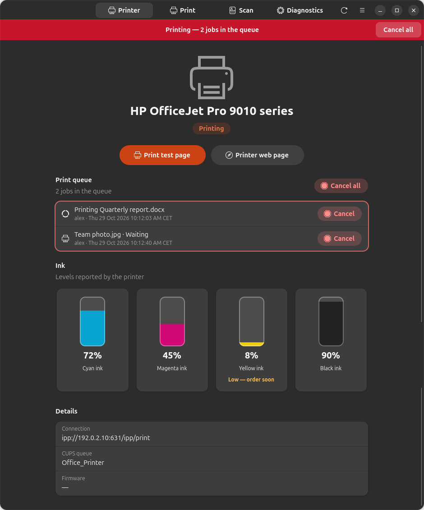
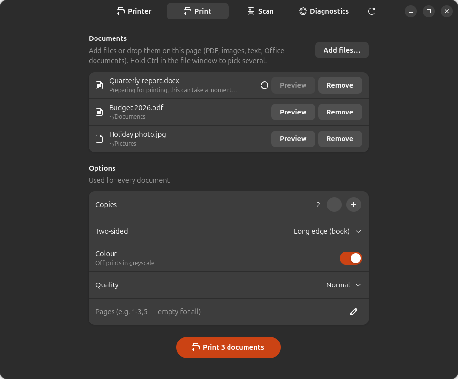
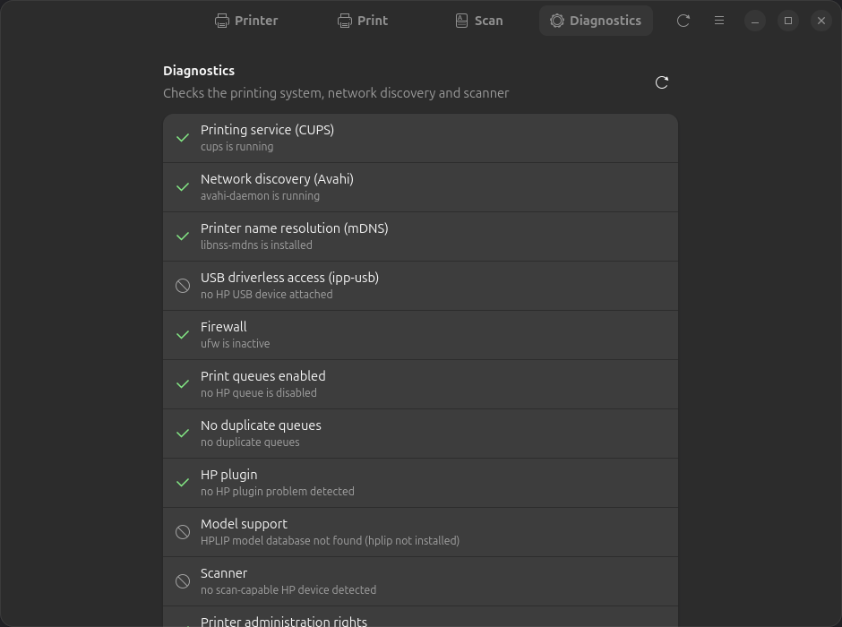

[English](README.md) · [Español](README.es.md) · [Deutsch](README.de.md) · Français · [Nederlands](README.nl.md)

<div align="center">



# LibrePrint

**Utilisez n'importe quelle imprimante sous Linux — imprimez, numérisez et vérifiez l'encre sans l'application du fabricant.**

[](https://github.com/juujbyg/libreprint/actions/workflows/ci.yml)
[](https://github.com/juujbyg/libreprint/releases/latest)
[](LICENSE)

</div>

Les applications des fabricants d'imprimantes pour Linux sont pénibles à utiliser, quand elles existent. LibrePrint trouve votre
imprimante (Wi-Fi, réseau ou USB), la configure avec le bon pilote et vous offre une application simple pour
imprimer, numériser, surveiller les niveaux d'encre et résoudre les problèmes — sous Ubuntu et Debian, en une seule commande.

Il fonctionne avec **toute imprimante prenant en charge l'impression sans pilote (IPP Everywhere / AirPrint)** — presque
tous les modèles vendus ces dix dernières années, de HP, Canon, Epson, Brother, Samsung, Xerox, Lexmark,
Kyocera, Ricoh et d'autres. Les **anciens modèles HP** antérieurs à l'impression sans pilote sont aussi pris en charge,
via HPLIP.

> **LibrePrint n'est ni affilié à, ni approuvé par, ni sponsorisé par un fabricant d'imprimantes.**
> Les noms de marques sont des marques déposées de leurs propriétaires, utilisés ici uniquement pour décrire les appareils
> avec lesquels l'outil fonctionne.

## Fonctionnalités

- **Configuration en une commande.** Détecte les imprimantes de toute marque sur le réseau ou en USB et crée la file
  d'impression avec IPP Everywhere sans pilote, en se rabattant sur HPLIP pour les anciens modèles HP.
- **Niveaux d'encre en un coup d'œil**, avec un avertissement quand une cartouche est presque vide.
- **File d'impression visible et contrôlable** — une bannière sur chaque écran pendant une impression, et
  un clic pour annuler un travail ou tous les travaux.
- **N'importe quel document, plusieurs à la fois** — les PDF, images et textes s'impriment directement. Les fichiers Word, Excel,
  PowerPoint, OpenDocument et similaires sont convertis avec LibreOffice en arrière-plan, et
  vous pouvez prévisualiser le résultat ou appuyer sur Imprimer sans attendre.
- **Options d'impression** — copies, recto verso, couleur ou niveaux de gris, qualité et plages de pages. L'ordre des pages
  suit le bac de sortie de l'imprimante, de sorte que la pile sort dans l'ordre de lecture.
- **Numérisation multipage** vers un seul PDF, ou vers PNG/JPEG, avec un aperçu de chaque page.
- **Diagnostic** qui vérifie CUPS, la détection réseau, le pare-feu et le scanner, et vous indique la
  commande qui corrige chaque problème.
- **Mode automatique** — branchez une imprimante USB ou rejoignez un réseau où il y en a une, et elle est configurée pour vous.

## Captures d'écran

| Impression | Numérisation | Diagnostic |
|:---:|:---:|:---:|
|  |  |  |

## Installation

**Option 1 — une seule commande (recommandée).** Ajoute le dépôt APT de LibrePrint, installe l'application et
configure votre imprimante. Vous recevez les mises à jour avec le reste de votre système (`sudo apt upgrade`) :

```sh
curl -fsSL https://juujbyg.github.io/libreprint/install.sh | sh
```

**Option 2 — ajouter le dépôt APT à la main :**

```sh
curl -fsSL https://juujbyg.github.io/libreprint/libreprint.gpg \
  | sudo tee /usr/share/keyrings/libreprint.gpg >/dev/null
echo "deb [signed-by=/usr/share/keyrings/libreprint.gpg] https://juujbyg.github.io/libreprint stable main" \
  | sudo tee /etc/apt/sources.list.d/libreprint.list
sudo apt update && sudo apt install libreprint
sudo libreprint setup
```

**Option 3 — uniquement le `.deb`.** Téléchargez `libreprint_all.deb` depuis la
[dernière version](https://github.com/juujbyg/libreprint/releases/latest) et exécutez
`sudo apt install ./libreprint_all.deb` (pas de mises à jour automatiques).

Ouvrez ensuite **LibrePrint** depuis le menu des applications, ou exécutez `libreprint gui`.

| | Ligne de commande | Application |
|---|---|---|
| Ubuntu 26.04, 24.04 | ✅ | ✅ |
| Ubuntu 22.04 | ✅ | — (nécessite libadwaita 1.5) |
| Debian 13 | ✅ | ✅ |
| Debian 12 | ✅ | — (nécessite libadwaita 1.5) |

amd64 et arm64. Python 3.10 ou plus récent, bibliothèque standard uniquement : rien n'est installé depuis PyPI.

## Comment ça marche

LibrePrint **n'est pas un nouveau pilote**. La prise en charge de votre imprimante existe très probablement déjà dans la
pile d'impression de Linux ; LibrePrint est le liant qui choisit la bonne brique et la raccorde. Il s'appuie sur :

- [CUPS](https://openprinting.github.io/cups/) et IPP Everywhere (impression sans pilote),
- [ipp-usb](https://github.com/OpenPrinting/ipp-usb) (accès sans pilote aux imprimantes USB),
- [HPLIP](https://developers.hp.com/hp-linux-imaging-and-printing) (pilotes pour les anciens modèles HP),
- [SANE](http://www.sane-project.org/) (`sane-airscan` pour eSCL, `hpaio` pour les scanners HPLIP).

## Ligne de commande

```
libreprint gui
libreprint setup [--uri URI] [--yes] [--no-test-page] [--force]
libreprint list [--json]
libreprint doctor [--json] [--fix]
libreprint plugin [--yes]
```

| Commande | Ce qu'elle fait |
|---|---|
| `libreprint gui` | Ouvre l'application LibrePrint (également dans le menu des applications). |
| `libreprint setup` | Détecte les imprimantes et crée leurs files d'impression (et la configuration du scanner). `--yes` répond automatiquement à toutes les questions. `--uri` configure un URI de périphérique précis au lieu de la détection. `--no-test-page` omet la page de test. `--force` reconfigure une file qui existe déjà. |
| `libreprint list` | Affiche les périphériques détectés sous la forme `MODÈLE  CONNEXION  MÉTHODE  FILE`. `--json` produit une sortie lisible par une machine. |
| `libreprint doctor` | Lance les diagnostics et affiche `[ OK ]` / `[FAIL]` / `[WARN]` / `[SKIP]` pour chacun, avec une commande de correction suggérée. `--fix` applique les correctifs disponibles. `--json` produit une sortie à joindre aux rapports de bogue. |
| `libreprint plugin` | Installe le greffon propriétaire de HP (voir [Licence du greffon HP](#licence-du-greffon-hp)), puis termine toute configuration qui l'attendait. |

`setup`, `plugin` et `doctor --fix` nécessitent les droits root. Lancés en tant qu'utilisateur normal dans un terminal,
LibrePrint se relance avec `sudo` ; sans terminal, il se termine avec le code 3.

Codes de sortie : `0` ok, `1` erreur, `2` usage, `3` nécessite root, `4` aucune imprimante trouvée, `5` action de l'utilisateur
requise (licence du greffon).

LibrePrint ne modifie ni ne supprime jamais une file d'impression qu'il n'a pas créée, sauf si vous passez `--force`.
Lancer `setup` deux fois ne change rien.

## Comment il choisit un pilote

Pour chaque imprimante trouvée, LibrePrint choisit la première méthode applicable :

1. **Sans pilote (IPP Everywhere).** Le périphérique annonce IPP Everywhere (formats raster comme
   `image/pwg-raster` ou `image/urf`) via le réseau ou `ipp-usb`. La file est
   créée avec `lpadmin -m everywhere` ; `ipps://` est préféré à `ipp://`.
2. **HPLIP** (HP uniquement). Le modèle figure comme pris en charge dans la base HPLIP installée
   (`/usr/share/hplip/data/models/models.dat`) et ne nécessite aucun greffon. La file utilise l'URI
   `hp:` et le pilote `hpcups` correspondant.
3. **HPLIP + greffon.** Comme ci-dessus, mais la base indique que le modèle nécessite le greffon de HP.
4. **Non pris en charge.** Une imprimante d'une autre marque sans prise en charge de l'impression sans pilote (installez le
   pilote Linux du fabricant), ou un modèle HP inconnu du HPLIP installé ou signalé comme non pris en charge
   par celui-ci ; LibrePrint explique pourquoi au lieu de deviner.

La numérisation est configurée séparément : les périphériques de toute marque qui annoncent eSCL (`_uscan._tcp`,
le protocole « AirScan ») utilisent `sane-airscan` ; sinon les modèles HP avec prise en charge de la numérisation utilisent `libsane-hpaio`.

Les paquets manquants (par exemple `sane-airscan`) sont installés avec `apt-get`, sauf si vous définissez
`install_packages = false`. HPLIP ne fait pas partie de l'installation normale : `hplip` et
`printer-driver-hpcups` ne sont installés que lorsqu'un modèle HP en a besoin.

## Ordre des pages

L'application lit le bac de sortie de l'imprimante via IPP. Si les pages arrivent face vers le haut, elle imprime la dernière page
en premier afin que la pile soit dans l'ordre de lecture. Si elles arrivent face vers le bas, elle imprime normalement, car
cette pile est déjà dans l'ordre. Les imprimantes qui ne signalent pas leur bac reçoivent la dernière page en premier.

## Mode automatique

Le paquet installe une règle udev et deux unités systemd :

- **USB :** quand une imprimante USB est branchée, `libreprint-usb@.service` exécute `libreprint auto --usb`.
- **Réseau :** `libreprint-netwatch.service` exécute `libreprint watch`, qui surveille mDNS (Avahi) pour détecter de nouvelles
  imprimantes. Les files partagées par les serveurs CUPS d'autres ordinateurs sont ignorées.
- Juste après l'installation, `libreprint auto --all` configure les imprimantes déjà connectées.

Le mode automatique ne pose jamais de questions, n'installe jamais le greffon HP sauf si vous l'avez accepté, et
ne supprime jamais de files (même quand une imprimante est débranchée).

Les paramètres se trouvent dans `/etc/libreprint/libreprint.conf` :

```ini
[libreprint]
usb = true                       # configure USB printers when plugged in
network = add                    # add | off: queues for network printers found by mDNS
accept_hp_plugin_license = false # see "HP plugin licensing" before changing this
install_packages = true          # let LibrePrint install missing packages with apt-get
```

Pour désactiver le mode automatique, définissez `usb = false` et `network = off`, ou exécutez
`sudo systemctl disable --now libreprint-netwatch.service`.

## Licence du greffon HP

Certains anciens modèles nécessitent le greffon propriétaire de HP. LibrePrint ne le redistribue **pas** ; il exécute
l'outil `hp-plugin` de HP, qui télécharge le greffon depuis HP et affiche la licence de HP.

- `sudo libreprint plugin` vous demande d'abord de lire et d'accepter la licence de HP.
- En mode automatique, le greffon n'est installé que si `accept_hp_plugin_license = true`. Définir
  cette option revient à accepter la licence de HP **au nom de tous les utilisateurs de la machine**. Sinon, LibrePrint
  note le modèle comme en attente et vous invite à exécuter `sudo libreprint plugin`.

## Dépannage

Lancez `libreprint doctor`. Il vérifie CUPS, Avahi et la résolution de noms mDNS, `ipp-usb`, un pare-feu
qui bloque mDNS (5353/udp), les files désactivées ou en double, un greffon HP absent ou incompatible,
les modèles absents de la base HPLIP, la visibilité du scanner et l'appartenance au groupe `lpadmin`.
Chaque vérification en échec est accompagnée d'une commande de correction ; `sudo libreprint doctor --fix` applique les correctifs.

## Signaler un problème

Ouvrez un ticket avec le modèle *Printer not working* et joignez la sortie de
`libreprint doctor --json` et de `libreprint list --json`. Une fois que votre imprimante fonctionne (ou non), ajoutez
une ligne à [docs/HARDWARE.md](docs/HARDWARE.md).

## Désinstallation

```sh
sudo apt remove libreprint
sudo rm -f /etc/apt/sources.list.d/libreprint.list /usr/share/keyrings/libreprint.gpg
```

Les files d'impression créées par LibrePrint sont **conservées**, afin que l'impression continue de fonctionner. Supprimez-les avec
`lpadmin -x <file>` si vous n'en voulez plus. `sudo apt purge libreprint` supprime aussi
`/var/lib/libreprint`.

## Développement

Lancez-le directement depuis un clone, sans installation :

```sh
git clone https://github.com/juujbyg/libreprint.git
cd libreprint
PYTHONPATH=src python3 -m libreprint gui     # or: list, doctor, ...
```

Consultez [CONTRIBUTING.md](CONTRIBUTING.md) pour les tests, le paquetage et les règles du projet, et
[docs/RELEASING.md](docs/RELEASING.md) pour publier une nouvelle version.

## Licence

GPL-2.0-or-later ; voir [LICENSE](LICENSE).
