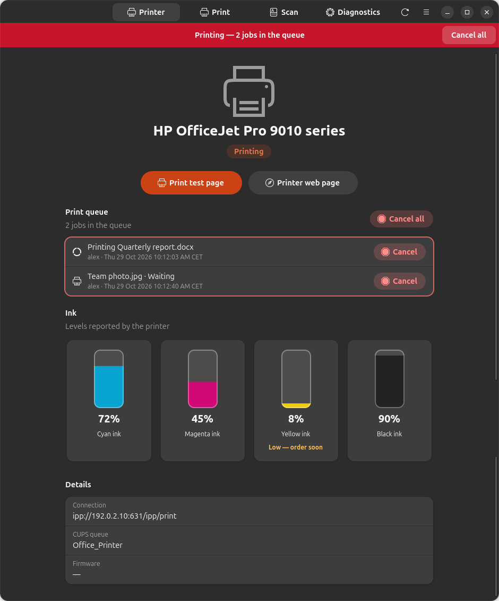
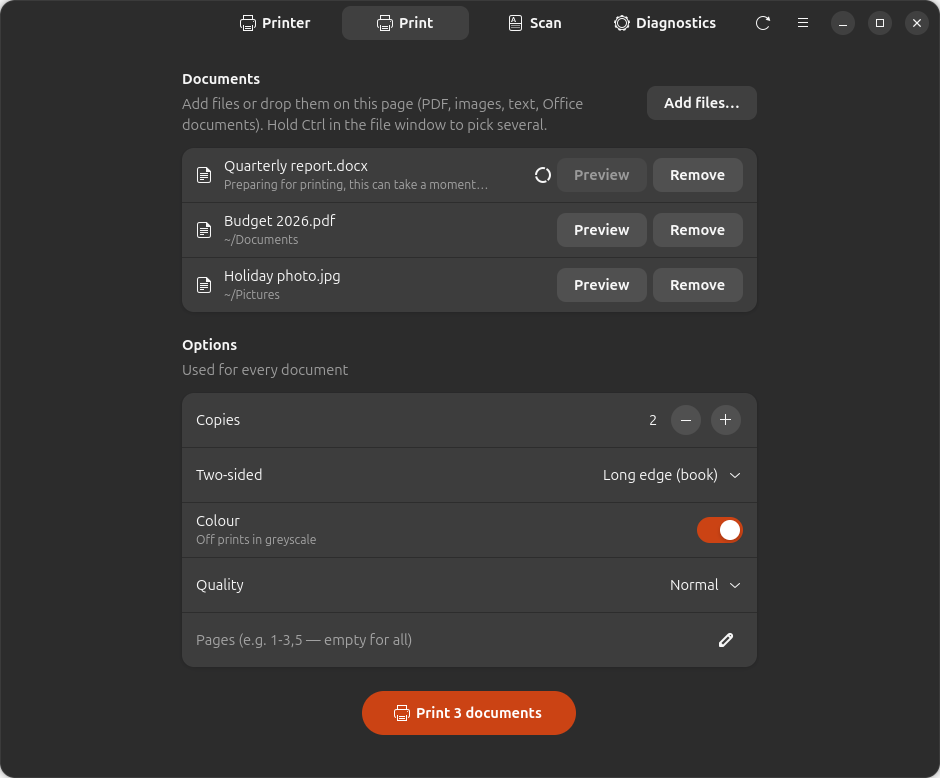
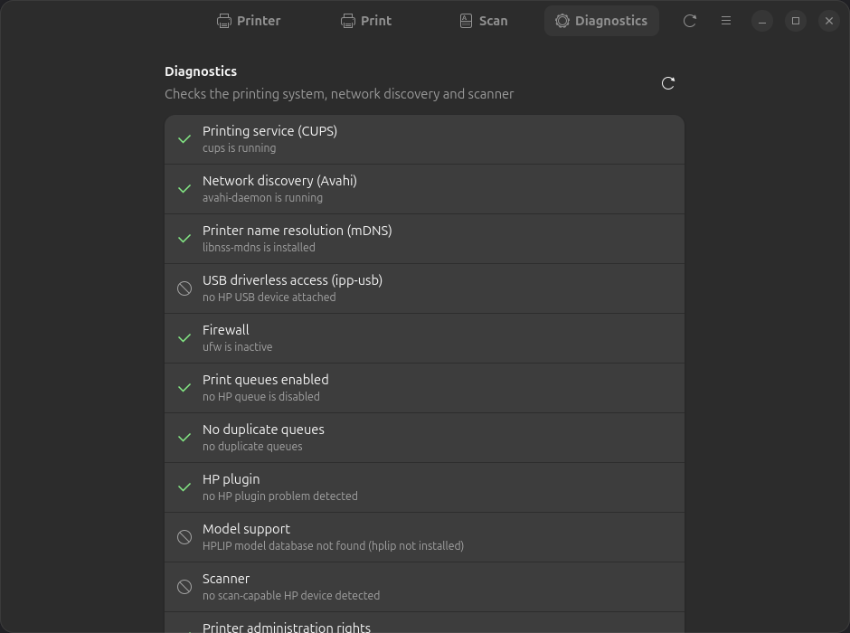

<div align="center">



# LibrePrint

**Use any printer on Linux — print, scan and check ink without the manufacturer's app.**

[](https://github.com/YOUR-USERNAME/libreprint/actions/workflows/ci.yml)
[](https://github.com/YOUR-USERNAME/libreprint/releases/latest)
[](LICENSE)

</div>

Printer makers' apps for Linux are hard to live with, when they exist at all. LibrePrint finds your
printer (Wi-Fi, network or USB), sets it up with the right driver, and gives you a simple app to
print, scan, watch ink levels and fix problems — on Ubuntu and Debian, with one command.

It works with **any printer that supports driverless printing (IPP Everywhere / AirPrint)** — almost
every model sold in the last ten years, from HP, Canon, Epson, Brother, Samsung, Xerox, Lexmark,
Kyocera, Ricoh and others. **Older HP models** that predate driverless printing are also covered,
through HPLIP.

> **LibrePrint is not affiliated with, endorsed by, or sponsored by any printer manufacturer.**
> Brand names are trademarks of their owners, used here only to describe the devices the tool
> works with.

## Features

- **One-command setup.** Detects printers of any make on the network or USB and creates the print
  queue with driverless IPP Everywhere, falling back to HPLIP for older HP models.
- **Ink levels at a glance**, with a warning when a cartridge is running low.
- **Print queue you can see and control** — a banner on every screen while something prints, and
  one click to cancel a job or all of them.
- **Printing options** — copies, two-sided, colour or greyscale, quality, page ranges, and
  last-page-first output so the stack comes out in order.
- **Multi-page scanning** to a single PDF, or to PNG/JPEG, with a preview of every page.
- **Diagnostics** that check CUPS, network discovery, firewall and scanner, and tell you the
  command that fixes each problem.
- **Automatic mode** — plug in a USB printer or join a network with one, and it is set up for you.

## Screenshots

| Print | Scan | Diagnostics |
|:---:|:---:|:---:|
|  |  |  |

## Install

**Option 1 — one command (recommended).** Adds the LibrePrint APT repository, installs the app and
sets up your printer. You get updates with the rest of your system (`sudo apt upgrade`):

```sh
curl -fsSL https://YOUR-USERNAME.github.io/libreprint/install.sh | sh
```

**Option 2 — add the APT repository by hand:**

```sh
curl -fsSL https://YOUR-USERNAME.github.io/libreprint/libreprint.gpg \
  | sudo tee /usr/share/keyrings/libreprint.gpg >/dev/null
echo "deb [signed-by=/usr/share/keyrings/libreprint.gpg] https://YOUR-USERNAME.github.io/libreprint stable main" \
  | sudo tee /etc/apt/sources.list.d/libreprint.list
sudo apt update && sudo apt install libreprint
sudo libreprint setup
```

**Option 3 — just the `.deb`.** Download `libreprint_all.deb` from the
[latest release](https://github.com/YOUR-USERNAME/libreprint/releases/latest) and run
`sudo apt install ./libreprint_all.deb` (no automatic updates).

Then open **LibrePrint** from your app menu, or run `libreprint gui`.

| | Command line | App |
|---|---|---|
| Ubuntu 26.04, 24.04 | ✅ | ✅ |
| Ubuntu 22.04 | ✅ | — (needs libadwaita 1.5) |
| Debian 13 | ✅ | ✅ |
| Debian 12 | ✅ | — (needs libadwaita 1.5) |

amd64 and arm64. Python 3.10 or newer, standard library only: nothing is installed from PyPI.

## How it works

LibrePrint is **not a new driver**. Support for your printer most likely already exists in the
Linux printing stack; LibrePrint is the glue that picks the right piece and wires it up. It builds on:

- [CUPS](https://openprinting.github.io/cups/) and IPP Everywhere (driverless printing),
- [ipp-usb](https://github.com/OpenPrinting/ipp-usb) (driverless access to USB printers),
- [HPLIP](https://developers.hp.com/hp-linux-imaging-and-printing) (drivers for older HP models),
- [SANE](http://www.sane-project.org/) (`sane-airscan` for eSCL, `hpaio` for HPLIP scanners).

## Command line

```
libreprint gui
libreprint setup [--uri URI] [--yes] [--no-test-page] [--force]
libreprint list [--json]
libreprint doctor [--json] [--fix]
libreprint plugin [--yes]
```

| Command | What it does |
|---|---|
| `libreprint gui` | Opens the LibrePrint app (also in your app menu). |
| `libreprint setup` | Detects printers and creates their print queues (and scanner setup). `--yes` answers every question automatically. `--uri` configures a specific device URI instead of discovering. `--no-test-page` skips the test page. `--force` reconfigures a queue that already exists. |
| `libreprint list` | Shows detected devices as `MODEL  CONNECTION  METHOD  QUEUE`. `--json` gives machine-readable output. |
| `libreprint doctor` | Runs diagnostics and prints `[ OK ]` / `[FAIL]` / `[WARN]` / `[SKIP]` for each, with a suggested fix command. `--fix` applies the available fixes. `--json` produces output to attach to bug reports. |
| `libreprint plugin` | Installs HP's proprietary plugin (see [HP plugin licensing](#hp-plugin-licensing)), then finishes any setup that was waiting for it. |

`setup`, `plugin` and `doctor --fix` need root. Run as a normal user in a terminal and LibrePrint
re-runs itself with `sudo`; without a terminal it exits with code 3.

Exit codes: `0` ok, `1` error, `2` usage, `3` needs root, `4` no printer found, `5` user action
required (plugin license).

LibrePrint never modifies or deletes a print queue it did not create unless you pass `--force`.
Running `setup` twice changes nothing.

## How it chooses a driver

For each printer found, LibrePrint picks the first method that applies:

1. **Driverless (IPP Everywhere).** The device advertises IPP Everywhere (raster formats such
   as `image/pwg-raster` or `image/urf`) over the network or through `ipp-usb`. The queue is
   created with `lpadmin -m everywhere`; `ipps://` is preferred over `ipp://`.
2. **HPLIP** (HP only). The model is listed as supported in the installed HPLIP database
   (`/usr/share/hplip/data/models/models.dat`) and needs no plugin. The queue uses the
   `hp:` URI and the matching `hpcups` driver.
3. **HPLIP + plugin.** Same as above, but the database marks the model as requiring HP's plugin.
4. **Unsupported.** A printer of another make without driverless support (install the
   manufacturer's Linux driver), or an HP model unknown to the installed HPLIP or listed as
   unsupported by it; LibrePrint says why instead of guessing.

Scanning is configured separately: devices of any make that advertise eSCL (`_uscan._tcp`,
the "AirScan" protocol) use `sane-airscan`; otherwise HP models with scan support use `libsane-hpaio`.

Missing packages (for example `hplip`, `printer-driver-hpcups`, `sane-airscan`) are installed
with `apt-get` unless you set `install_packages = false`.

## Automatic mode

The package installs a udev rule and two systemd units:

- **USB:** when a USB printer is plugged in, `libreprint-usb@.service` runs `libreprint auto --usb`.
- **Network:** `libreprint-netwatch.service` runs `libreprint watch`, which watches mDNS (Avahi) for new
  printers. Queues shared by other computers' CUPS servers are ignored.
- Right after installation, `libreprint auto --all` configures printers that are already connected.

Automatic mode never asks questions, never installs the HP plugin unless you opted in, and
never deletes queues (even when a printer is unplugged).

Settings live in `/etc/libreprint/libreprint.conf`:

```ini
[libreprint]
usb = true                       # configure USB printers when plugged in
network = add                    # add | off: queues for network printers found by mDNS
accept_hp_plugin_license = false # see "HP plugin licensing" before changing this
install_packages = true          # let LibrePrint install missing packages with apt-get
```

To disable automatic mode, set `usb = false` and `network = off`, or run
`sudo systemctl disable --now libreprint-netwatch.service`.

## HP plugin licensing

Some older models need HP's proprietary plugin. LibrePrint does **not** redistribute it; it runs
HP's own `hp-plugin` tool, which downloads the plugin from HP and shows HP's license.

- `sudo libreprint plugin` asks you to read and accept HP's license first.
- In automatic mode the plugin is only installed if `accept_hp_plugin_license = true`. Setting
  it means accepting HP's license **on behalf of every user of the machine**. Otherwise LibrePrint
  records the model as pending and tells you to run `sudo libreprint plugin`.

## Troubleshooting

Run `libreprint doctor`. It checks CUPS, Avahi and mDNS name resolution, `ipp-usb`, a firewall
blocking mDNS (5353/udp), disabled or duplicate queues, a missing or mismatched HP plugin,
models missing from the HPLIP database, scanner visibility, and `lpadmin` group membership.
Each failing check comes with a fix command; `sudo libreprint doctor --fix` applies the fixes.

## Reporting a problem

Open an issue using the *Printer not working* template and attach the output of
`libreprint doctor --json` and `libreprint list --json`. Once your printer works (or does not), please
add a line to [docs/HARDWARE.md](docs/HARDWARE.md).

## Uninstall

```sh
sudo apt remove libreprint
sudo rm -f /etc/apt/sources.list.d/libreprint.list /usr/share/keyrings/libreprint.gpg
```

Print queues created by LibrePrint are **kept**, so printing keeps working. Remove them with
`lpadmin -x <queue>` if you want them gone. `sudo apt purge libreprint` also deletes
`/var/lib/libreprint`.

## Development

Run it straight from a clone, no install needed:

```sh
git clone https://github.com/YOUR-USERNAME/libreprint.git
cd libreprint
PYTHONPATH=src python3 -m libreprint gui     # or: list, doctor, ...
```

See [CONTRIBUTING.md](CONTRIBUTING.md) for tests, packaging and the project's ground rules, and
[docs/RELEASING.md](docs/RELEASING.md) for publishing a new version.

## License

GPL-2.0-or-later; see [LICENSE](LICENSE).
