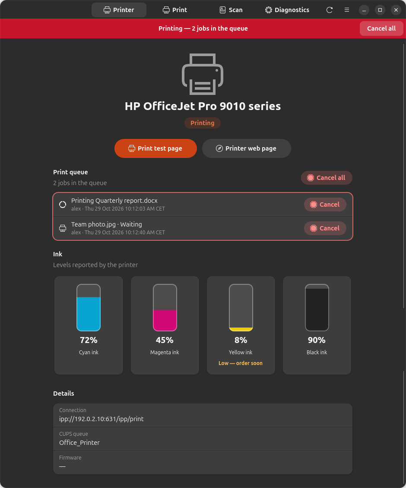
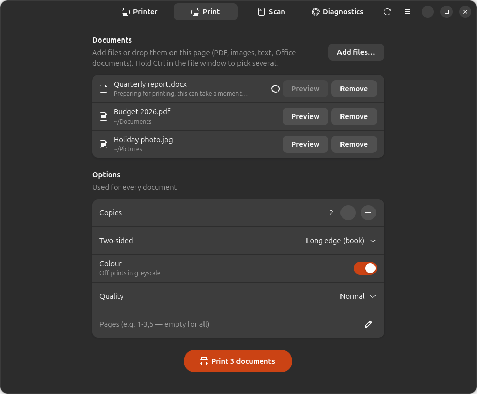
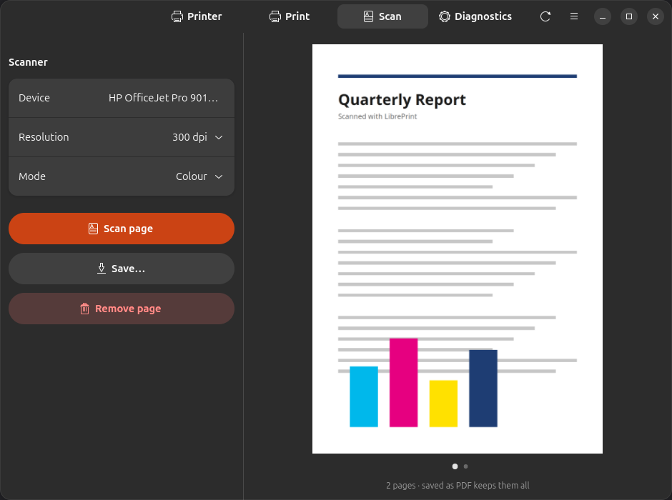
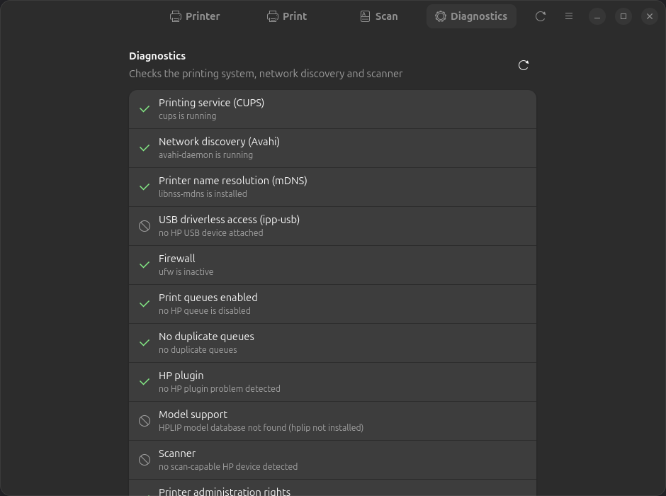

[English](README.md) · [Español](README.es.md) · [Deutsch](README.de.md) · [Français](README.fr.md) · **Nederlands**

<div align="center">



# LibrePrint

**Gebruik elke printer onder Linux — print, scan en controleer de inkt zonder de app van de fabrikant.**

[](https://github.com/juujbyg/libreprint/actions/workflows/ci.yml)
[](https://github.com/juujbyg/libreprint/releases/latest)
[](LICENSE)

</div>

De apps van printerfabrikanten voor Linux zijn lastig in gebruik, voor zover ze al bestaan. LibrePrint vindt uw
printer (wifi, netwerk of USB), stelt hem in met het juiste stuurprogramma en biedt een eenvoudige app om
te printen, te scannen, de inktniveaus te volgen en problemen op te lossen — op Ubuntu en Debian, met één commando.

Het werkt met **elke printer die driverloos printen ondersteunt (IPP Everywhere / AirPrint)** — bijna
elk model dat de afgelopen tien jaar is verkocht, van HP, Canon, Epson, Brother, Samsung, Xerox, Lexmark,
Kyocera, Ricoh en andere. **Oudere HP-modellen** van vóór het driverloze printen worden ook ondersteund,
via HPLIP.

> **LibrePrint is niet verbonden aan, goedgekeurd door of gesponsord door een printerfabrikant.**
> Merknamen zijn handelsmerken van hun eigenaren en worden hier alleen gebruikt om de apparaten te beschrijven
> waarmee het hulpmiddel werkt.

## Functies

- **Instellen met één commando.** Detecteert printers van elk merk op het netwerk of via USB en maakt de
  printerwachtrij aan met driverloos IPP Everywhere, met HPLIP als terugvaloptie voor oudere HP-modellen.
- **Inktniveaus in één oogopslag**, met een waarschuwing wanneer een cartridge bijna leeg is.
- **Zichtbare en bestuurbare printerwachtrij** — een banner op elk scherm tijdens het printen en
  met één klik breekt u een taak of alle taken af.
- **Elk document, meerdere tegelijk** — pdf's, afbeeldingen en tekst worden direct afgedrukt. Word-, Excel-,
  PowerPoint-, OpenDocument- en vergelijkbare bestanden worden op de achtergrond met LibreOffice geconverteerd, en
  u kunt het resultaat bekijken of op Afdrukken drukken zonder te wachten.
- **Afdrukopties** — kopieën, dubbelzijdig, kleur of grijswaarden, kwaliteit en paginabereiken. De paginavolgorde
  past zich aan de uitvoerlade van de printer aan, zodat de stapel in leesvolgorde uitkomt.
- **Meerpaginascans** naar één pdf, of naar PNG/JPEG, met een voorbeeld van elke pagina.
- **Diagnostiek** die CUPS, netwerkdetectie, firewall en scanner controleert en u het
  commando geeft dat elk probleem verhelpt.
- **Automatische modus** — sluit een USB-printer aan of maak verbinding met een netwerk waar er een is, en hij wordt voor u ingesteld.

## Schermafbeeldingen

| Printen | Scannen | Diagnostiek |
|:---:|:---:|:---:|
|  |  |  |

## Installatie

**Optie 1 — één commando (aanbevolen).** Voegt de APT-opslagplaats van LibrePrint toe, installeert de app en
stelt uw printer in. U ontvangt updates samen met de rest van uw systeem (`sudo apt upgrade`):

```sh
curl -fsSL https://juujbyg.github.io/libreprint/install.sh | sh
```

**Optie 2 — de APT-opslagplaats handmatig toevoegen:**

```sh
curl -fsSL https://juujbyg.github.io/libreprint/libreprint.gpg \
  | sudo tee /usr/share/keyrings/libreprint.gpg >/dev/null
echo "deb [signed-by=/usr/share/keyrings/libreprint.gpg] https://juujbyg.github.io/libreprint stable main" \
  | sudo tee /etc/apt/sources.list.d/libreprint.list
sudo apt update && sudo apt install libreprint
sudo libreprint setup
```

**Optie 3 — alleen het `.deb`-bestand.** Download `libreprint_all.deb` van de
[nieuwste uitgave](https://github.com/juujbyg/libreprint/releases/latest) en voer
`sudo apt install ./libreprint_all.deb` uit (geen automatische updates).

Open daarna **LibrePrint** vanuit het toepassingenmenu, of voer `libreprint gui` uit.

| | Opdrachtregel | App |
|---|---|---|
| Ubuntu 26.04, 24.04 | ✅ | ✅ |
| Ubuntu 22.04 | ✅ | — (vereist libadwaita 1.5) |
| Debian 13 | ✅ | ✅ |
| Debian 12 | ✅ | — (vereist libadwaita 1.5) |

amd64 en arm64. Python 3.10 of nieuwer, alleen de standaardbibliotheek: er wordt niets van PyPI geïnstalleerd.

## Hoe het werkt

LibrePrint is **geen nieuw stuurprogramma**. Ondersteuning voor uw printer bestaat zeer waarschijnlijk al in de
afdrukstack van Linux; LibrePrint is de lijm die het juiste onderdeel kiest en aansluit. Het bouwt voort op:

- [CUPS](https://openprinting.github.io/cups/) en IPP Everywhere (driverloos printen),
- [ipp-usb](https://github.com/OpenPrinting/ipp-usb) (driverloze toegang tot USB-printers),
- [HPLIP](https://developers.hp.com/hp-linux-imaging-and-printing) (stuurprogramma's voor oudere HP-modellen),
- [SANE](http://www.sane-project.org/) (`sane-airscan` voor eSCL, `hpaio` voor HPLIP-scanners).

## Opdrachtregel

```
libreprint gui
libreprint setup [--uri URI] [--yes] [--no-test-page] [--force]
libreprint list [--json]
libreprint doctor [--json] [--fix]
libreprint plugin [--yes]
```

| Commando | Wat het doet |
|---|---|
| `libreprint gui` | Opent de LibrePrint-app (ook beschikbaar in het toepassingenmenu). |
| `libreprint setup` | Detecteert printers en maakt hun printerwachtrijen aan (en de scannerconfiguratie). `--yes` beantwoordt alle vragen automatisch. `--uri` stelt een specifiek apparaatadres in in plaats van te zoeken. `--no-test-page` slaat de testpagina over. `--force` stelt een bestaande wachtrij opnieuw in. |
| `libreprint list` | Toont de gedetecteerde apparaten als `MODEL  VERBINDING  METHODE  WACHTRIJ`. `--json` geeft machineleesbare uitvoer. |
| `libreprint doctor` | Voert de diagnoses uit en toont per controle `[ OK ]` / `[FAIL]` / `[WARN]` / `[SKIP]`, met een voorgesteld herstelcommando. `--fix` past de beschikbare oplossingen toe. `--json` geeft uitvoer om bij foutmeldingen te voegen. |
| `libreprint plugin` | Installeert de eigen plug-in van HP (zie [Licentie van de HP-plug-in](#licentie-van-de-hp-plug-in)) en rondt daarna de installatie af die erop wachtte. |

`setup`, `plugin` en `doctor --fix` vereisen root-rechten. Als gewone gebruiker in een terminal gestart,
start LibrePrint zichzelf opnieuw met `sudo`; zonder terminal stopt het met code 3.

Afsluitcodes: `0` ok, `1` fout, `2` gebruik, `3` vereist root, `4` geen printer gevonden, `5` handeling van de gebruiker
vereist (plug-inlicentie).

LibrePrint wijzigt of verwijdert nooit een printerwachtrij die het niet zelf heeft aangemaakt, tenzij u `--force` opgeeft.
Twee keer `setup` uitvoeren verandert niets.

## Hoe een stuurprogramma wordt gekozen

Voor elke gevonden printer kiest LibrePrint de eerste methode die van toepassing is:

1. **Driverloos (IPP Everywhere).** Het apparaat meldt IPP Everywhere (rasterformaten zoals
   `image/pwg-raster` of `image/urf`) via het netwerk of `ipp-usb`. De wachtrij wordt
   aangemaakt met `lpadmin -m everywhere`; `ipps://` heeft de voorkeur boven `ipp://`.
2. **HPLIP** (alleen HP). Het model staat als ondersteund in de geïnstalleerde HPLIP-database
   (`/usr/share/hplip/data/models/models.dat`) en heeft geen plug-in nodig. De wachtrij gebruikt de
   `hp:`-URI en het bijbehorende `hpcups`-stuurprogramma.
3. **HPLIP + plug-in.** Zoals hierboven, maar de database geeft aan dat het model de plug-in van HP nodig heeft.
4. **Niet ondersteund.** Een printer van een ander merk zonder ondersteuning voor driverloos printen (installeer het
   Linux-stuurprogramma van de fabrikant), of een HP-model dat HPLIP niet kent of als niet ondersteund
   markeert; LibrePrint legt uit waarom in plaats van te gokken.

Scannen wordt apart ingesteld: apparaten van elk merk die eSCL melden (`_uscan._tcp`, het
“AirScan”-protocol) gebruiken `sane-airscan`; anders gebruiken HP-modellen met scanondersteuning `libsane-hpaio`.

Ontbrekende pakketten (bijvoorbeeld `sane-airscan`) worden met `apt-get` geïnstalleerd, tenzij u
`install_packages = false` instelt. HPLIP maakt geen deel uit van de normale installatie: `hplip` en
`printer-driver-hpcups` worden alleen geïnstalleerd wanneer een HP-model ze nodig heeft.

## Paginavolgorde

De app leest de uitvoerlade van de printer via IPP. Als de pagina's met de bedrukte kant naar boven uitkomen, drukt hij de laatste pagina
eerst af, zodat de stapel in leesvolgorde ligt. Komen ze met de bedrukte kant naar beneden uit, dan drukt hij normaal af, omdat
die stapel al in de juiste volgorde ligt. Printers die hun lade niet melden, krijgen eerst de laatste pagina.

## Automatische modus

Het pakket installeert een udev-regel en twee systemd-units:

- **USB:** wanneer een USB-printer wordt aangesloten, voert `libreprint-usb@.service` `libreprint auto --usb` uit.
- **Netwerk:** `libreprint-netwatch.service` voert `libreprint watch` uit, dat mDNS (Avahi) in de gaten houdt voor nieuwe
  printers. Wachtrijen die CUPS-servers van andere computers delen, worden genegeerd.
- Direct na de installatie stelt `libreprint auto --all` de reeds aangesloten printers in.

De automatische modus stelt nooit vragen, installeert de HP-plug-in nooit tenzij u dat hebt geaccepteerd, en
verwijdert nooit wachtrijen (ook niet wanneer een printer wordt losgekoppeld).

De instellingen staan in `/etc/libreprint/libreprint.conf`:

```ini
[libreprint]
usb = true                       # configure USB printers when plugged in
network = add                    # add | off: queues for network printers found by mDNS
accept_hp_plugin_license = false # see "HP plugin licensing" before changing this
install_packages = true          # let LibrePrint install missing packages with apt-get
```

Om de automatische modus uit te schakelen, stelt u `usb = false` en `network = off` in, of voert u
`sudo systemctl disable --now libreprint-netwatch.service` uit.

## Licentie van de HP-plug-in

Sommige oudere modellen hebben de eigen plug-in van HP nodig. LibrePrint verspreidt deze **niet**; het voert
het hulpprogramma `hp-plugin` van HP uit, dat de plug-in van HP downloadt en de licentie van HP toont.

- `sudo libreprint plugin` vraagt u eerst de licentie van HP te lezen en te accepteren.
- In de automatische modus wordt de plug-in alleen geïnstalleerd als `accept_hp_plugin_license = true`. Het instellen
  van die optie staat gelijk aan het accepteren van de licentie van HP **namens alle gebruikers van de machine**. Anders
  noteert LibrePrint het model als wachtend en vraagt het u `sudo libreprint plugin` uit te voeren.

## Problemen oplossen

Voer `libreprint doctor` uit. Het controleert CUPS, Avahi en mDNS-naamomzetting, `ipp-usb`, een firewall
die mDNS blokkeert (5353/udp), uitgeschakelde of dubbele wachtrijen, een ontbrekende of niet-passende HP-plug-in,
modellen die niet in de HPLIP-database staan, de zichtbaarheid van de scanner en het lidmaatschap van de groep `lpadmin`.
Bij elke mislukte controle hoort een herstelcommando; `sudo libreprint doctor --fix` past de oplossingen toe.

## Een probleem melden

Open een issue met het sjabloon *Printer not working* en voeg de uitvoer van
`libreprint doctor --json` en `libreprint list --json` toe. Zodra uw printer werkt (of niet), voegt u
een regel toe aan [docs/HARDWARE.md](docs/HARDWARE.md).

## Verwijderen

```sh
sudo apt remove libreprint
sudo rm -f /etc/apt/sources.list.d/libreprint.list /usr/share/keyrings/libreprint.gpg
```

De door LibrePrint aangemaakte printerwachtrijen blijven **behouden**, zodat het printen blijft werken. Verwijder ze met
`lpadmin -x <wachtrij>` als u ze niet meer wilt. `sudo apt purge libreprint` verwijdert ook
`/var/lib/libreprint`.

## Ontwikkeling

Voer het direct uit vanuit een kloon, zonder installatie:

```sh
git clone https://github.com/juujbyg/libreprint.git
cd libreprint
PYTHONPATH=src python3 -m libreprint gui     # or: list, doctor, ...
```

Zie [CONTRIBUTING.md](CONTRIBUTING.md) voor tests, verpakking en projectregels, en
[docs/RELEASING.md](docs/RELEASING.md) voor het uitbrengen van een nieuwe versie.

## Licentie

GPL-2.0-or-later; zie [LICENSE](LICENSE).
